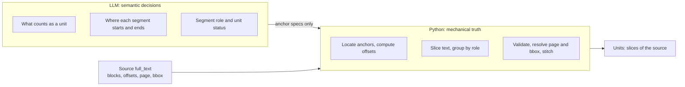
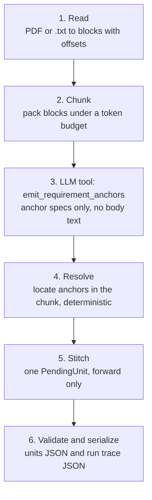
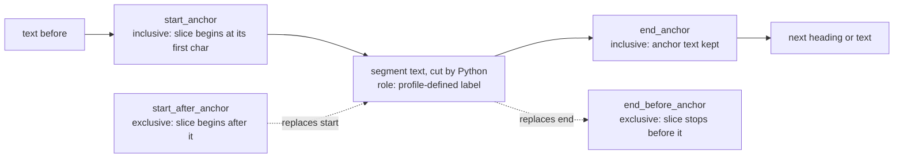
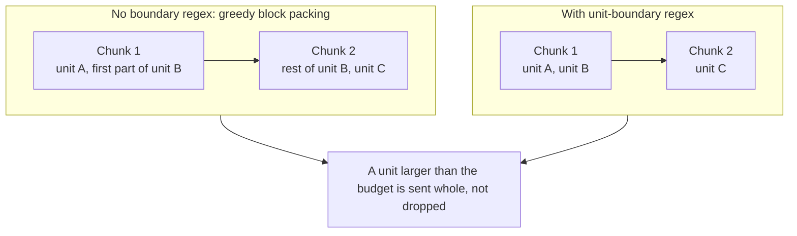
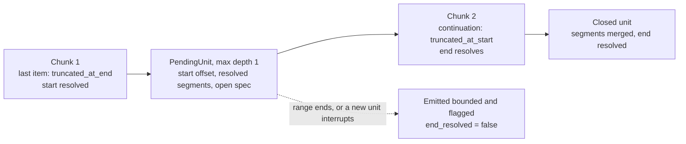
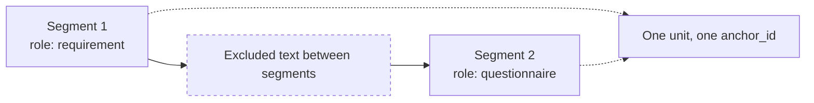

# Anchors, Not Bodies: Verifiable Extraction from Long PDFs

**The LLM decides where a unit begins and ends. Python cuts the text. Every output is a slice of the source you can check.**

## The problem

Long structured PDFs (standards, policies, specifications, contracts) have to be split into logical units. Each unit must point back to its exact place in the source. Two failure modes show up with the obvious approach:

- **Boundary errors.** Fixed page or token windows cut a unit in half. Overlap-based stitching then produces divergent duplicates.
- **Loss of verifiability.** If the model writes the unit body, it paraphrases, drops clauses, and cannot reliably report character offsets. You cannot diff the output against the source.

A third problem appears when a unit is non-contiguous. Its parts belong together but are separated by prose you want to exclude. They still have to stay linked as one record.

## The core idea: anchors, not bodies

The model never returns unit body text. For each unit it returns only **anchors**: short substrings, copied verbatim from the document, that mark where each segment starts and ends. It also returns a status and, optionally, a per-segment role.

The work is split in two layers. The model makes judgments. Code does the bookkeeping. The model never produces an offset, a page number, or body text.

*Diagram 1. Two layers. The model returns anchors, Python produces the text.*

## How it works

1. **Read.** A text-extractable PDF (PyMuPDF) or a plain `.txt` file becomes a list of blocks with character offsets, page, and bounding box. Headers, footers, and page numbers are dropped by default. The source hash is the SHA-256 of the raw file bytes.
2. **Chunk.** Blocks are packed under a token budget. If the profile supplies a unit-boundary regex, whole units are packed together and a unit is never split across chunks.
3. **Extract anchors.** Each chunk goes to the LLM through tool use. The tool is `emit_requirement_anchors`. It returns the anchor specs for each unit.
4. **Resolve deterministically.** Python searches for each anchor in the chunk.
5. **Stitch forward.** A unit that runs past the end of a chunk is carried to the next chunk.
6. **Validate and serialize.** Slices are grouped by role and checked. Output is JSON: a units deliverable and a full run trace.

*Diagram 2. End-to-end pipeline.*

### What an anchor is

Each segment carries a start boundary and an end boundary. Inclusive anchors keep their own text in the slice. Exclusive anchors do not. `start_anchor` is a verbatim, unique substring, usually the heading and the first sentence, so it does not collide with a table of contents or a cross-reference. If both start forms are given, `start_after_anchor` wins. If both end forms are given, `end_before_anchor` wins.

*Diagram 3. The anchor contract on one line of source text. Solid arrows are the default inclusive form, dotted arrows are the exclusive alternatives.*

### Resolution, without guessing

Python tolerates whitespace and typographic punctuation differences (curly quotes, en and em dashes). There is no fuzzy matching, because a wrong location is worse than a failed extraction. A shortened-prefix fallback for starts, and a shortened-suffix fallback for ends, are accepted only when the match is unique in the allowed window. If it is not unique, the segment is left unresolved and flagged `ambiguous`. For a single-span unit the engine then checks that `full_text[doc_offset_start:doc_offset_end] == original_text`.

The canonical name for the deliverable is **unit** (`ExtractedUnit`, `extraction.units`). The older "requirement" names remain as deprecated, read-only aliases.

## Why this is better than naive body extraction

| | Naive: LLM returns the text | Anchor engine |
|---|---|---|
| **Output text** | Whatever the model wrote | A slice of the source, cut by Python |
| **Verifiability** | Compare by eye or fuzzy match | Offsets plus an equality check for single-span units |
| **Failure behavior** | Silent paraphrase or dropped clause | Unresolved or ambiguous anchors are emitted and flagged, never silently dropped |
| **Re-runs and dedup** | No stable key | `span_key`: `{pdf_hash[:12]}:{doc_offset_start}` |
| **Chunk boundaries** | Cut wherever the window ends | Whole units kept together when a boundary regex is set; a single forward stitch otherwise |

What this buys in practice:

- **Verifiable against the source.** The text in the deliverable comes from the document, not from the model. The model's influence is limited to choosing boundaries, and those choices are recorded in the trace.
- **Fewer paraphrased or invented clauses.** The model cannot rewrite text it is never asked to write. A bad anchor produces a flagged span, not a plausible fake.
- **Stable positions.** Each unit gets two ids from the engine. `anchor_id` is the 1-based reading-order number. `span_key` is positional and is used for dedup and comparing runs. The identifier printed in the source (for example a section number) travels verbatim in segment `metadata`, and the engine never reads it.
- **Controllable chunking.** An optional Python regex marks where a new unit starts, so a unit and its trailing segments land in one API call.
- **Non-contiguous units.** One unit can be several disjoint segments, each with a role. Text between segments is excluded on purpose. For these units the single-slice invariant does not apply. Each segment is checked on its own.

The engine is deterministic after the anchors are chosen. Given the same `full_text` and the same anchors, the output is reproducible. The only non-deterministic part is which anchors the model picks.

## Chunking and stitching

Chunking and stitching are the two mechanisms that deal with unit boundaries. The diagrams below show them.

*Diagram 4. Greedy packing can end a chunk inside a unit. With a unit-boundary regex, chunks end between units.*

When a unit does cross a chunk boundary, the stitcher holds exactly one `PendingUnit` and moves forward only.

*Diagram 5. Forward stitch. The cursor never goes back. If the unit cannot close on a confirmed end, it is emitted bounded and flagged, not dropped.*

A unit can also be several disjoint segments linked by one `anchor_id`. The text between them is excluded on purpose.

*Diagram 6. A non-contiguous unit. Roles shown are the bundled AI RMF Playbook convention.*

## Limits, stated plainly

- The model must copy anchors **verbatim**. Small or weak models degrade quickly.
- The input must be a **text-extractable PDF**. Scanned images are unsupported; there is no OCR.
- `full_text` is normalized for extraction (hyphenation repair, whitespace collapse). It is not a pixel-exact copy of the PDF.
- The stitcher holds **one** pending unit at a time.
- Anything that cannot close on a confirmed end is still emitted, bounded deterministically, and flagged. Flags need triage.
- The engine does not validate source identifiers such as section numbers. Checking those against the source's own numbering is the consumer's job.
- Bundled example profiles are tuned for English regulatory prose.

## Who it is for

Teams that need extracted units they can audit: standards, policies, specifications, long structured documents. The core engine is domain-agnostic. A profile (a detection prompt plus an optional boundary regex) specializes it. HIPAA and the NIST AI RMF Playbook ship as examples.

Provider setup lives in `.env.example` in the repository.

---

## Exporting the diagrams

LinkedIn native posts do not render Mermaid. Every diagram above renders in a GitHub or VS Code Markdown preview. For a post, screenshot the rendered diagram and attach it as an image. No static image files are required to read this article.

## LinkedIn caption (short)

Most LLM extraction pipelines ask the model to rewrite the text. We ask it only where each unit starts and ends. Python locates the anchors, slices the source, and flags anything it cannot confirm, so every unit stays checkable against the document. Diagrams of the pipeline are attached as screenshots.

#PDF #LLM #Provenance #DocumentProcessing #Python
